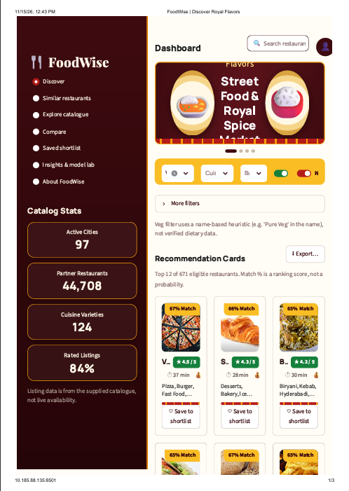

# 🍴 FoodWise — Restaurant Recommendation System

A restaurant discovery app that recommends restaurants by city, cuisine, budget and diet, and **explains why** each one was picked. Built with Python, Pandas, Scikit-learn and Streamlit.



## Why I built this

Most restaurant apps show a long list sorted by popularity. I wanted to build a recommender where I could see and control *how* the ranking is made, and then test it honestly. This project covers the full data science flow: data cleaning, feature engineering, a content-based ranking model, a supervised rating-prediction model, offline evaluation, tests and a working web app.

## What it does

- **Recommends** restaurants from filters: city, cuisine, budget, veg / non-veg, minimum rating.
- **Explains** every result with a match % and a short reason.
- **Finds similar restaurants** to one you already like.
- **Searches and compares** restaurants (up to 4 side by side) and keeps a saved shortlist.
- **Shows dish photos** on the cards, picked from the restaurant name and cuisine.
- **Exports** results to CSV.
- **Estimates ratings for unrated listings** with a supervised ML model (gradient boosting), clearly labelled as estimates.
- **Insights page** with charts of cities, cuisines, ratings and prices, a ranking comparison and the rating model results.

## Dataset

Zomato restaurant listings (CSV in `data/raw/`). After cleaning: **44,708 restaurants, 97 cities, 124 cuisine tags**.

Columns: restaurant name, rating, cuisine, average price, average delivery time, safety measure, location.

## How it works

**1. Cleaning (`src/preprocessing.py`)**
Checks required columns, removes duplicates and closed / test listings, merges city names (Delhi, New Delhi → NCR), turns text like `₹250 for one` and `25 min` into numbers, and handles missing ratings (`-`, `New`).

**2. Features**
Each restaurant becomes a text profile: cuisine tags, city, price tier and a veg hint from the name. TF-IDF (unigrams and bigrams) turns the profile into a sparse vector. The user's chosen cuisines become a query vector, and cosine similarity gives the cuisine match.

**3. Ranking (`src/recommender.py`)**
The final score is a weighted sum:

$$S = 0.48\,C + 0.25\,R + 0.17\,P + 0.07\,D + 0.03\,L$$

| Symbol | Meaning |
|---|---|
| C | Cuisine / profile similarity |
| R | Rating |
| P | Price fit with the budget |
| D | Listed delivery time |
| L | Safety label from the dataset (low weight, it is not a real inspection) |

The weights are in `src/config.py`. A diversity step (Maximal Marginal Relevance) then avoids near-duplicate results, and chain outlets (like Pizza Hut) appear only once.

**4. Rating prediction model (`src/ml_model.py`) — supervised ML**
About 16% of listings have no rating. The ranking used to give them a flat 3.5, but the real average is about 3.9, so new restaurants were unfairly pushed down. I trained a gradient boosting regressor that predicts a rating from cuisine tags, city, price, delivery time, veg hint and safety label. Its estimate replaces the flat 3.5 inside the ranking. In the app it is shown as "Unrated · est. 3.9", never as a real rating.

- Inputs never include the rating itself or the restaurant name, so there is no leakage.
- Train / test split is **grouped by restaurant name**, so outlets of one chain cannot appear on both sides.

**5. Dish photos (`src/food_images.py`)**
The dataset has no photos, and showing another place's photo as the restaurant's own would be misleading. So each card shows an illustrative photo of the *dish*. The dish is picked from the restaurant name first ("Hyderabad Biryani House" shows biryani), then from the cuisine tags. Photos come from Wikipedia / Wikimedia Commons. If there is no internet, the card shows emoji art. Photos can be turned off under "More filters".

## Results

### Rating prediction model

Trained on 30,310 rated listings, tested on 7,448 unseen restaurants.

| Model | MAE | RMSE | R² |
|---|---|---|---|
| Constant 3.5 (old fallback) | 0.486 | 0.554 | -1.475 |
| Predict the average | 0.281 | 0.352 | 0.000 |
| Ridge regression | 0.263 | 0.333 | 0.107 |
| **Gradient boosting (used)** | **0.259** | **0.327** | **0.134** |

MAE and RMSE are in rating points (lower is better).

- The new estimate is much closer to real ratings than the old flat 3.5 (MAE 0.26 vs 0.49).
- The improvement over just predicting the average is small (R² about 0.13). Ratings are noisy and the data has no review counts, so the features can only explain a little. I report this as it is.
- Cuisine tags and city matter most (permutation importance). Price and veg hint barely matter.
- Unrated listings may differ from rated ones (many are new), so the estimates cannot be checked against real ratings.

Full walkthrough with charts: `notebooks/04_rating_prediction.ipynb`.

### Ranking comparison

I compared four methods on 10 fixed city / cuisine / budget scenarios. All use the same filters and one listing per restaurant name.

| Method | Cuisine Match@5 | Mean rating | Mean price (₹) | Diversity |
|---|---|---|---|---|
| Random (eligible) | 0.50 | 4.03 | 153 | 0.82 |
| Top-rated (cuisine filter) | 1.00 | 4.47 | 151 | 0.73 |
| Content-based | 1.00 | 4.06 | 159 | 0.33 |
| FoodWise hybrid | 1.00 | 4.16 | 148 | 0.39 |

**What I found**
- "Cuisine Match" only counts shared cuisine tags, so content-based methods score 1.0 by design. It is a sanity check, not proof of quality.
- The hybrid beats pure content-based on rating and price, and is a bit more diverse.
- A simple "top-rated within the cuisine" list has the best average rating. The hybrid's value is its price fit, delivery time, similarity scoring and explanations, not raw rating.

## Limitations

- The data has no user clicks, orders, reviews or location coordinates. So I **cannot** measure real user satisfaction, and collaborative filtering is not possible.
- Delivery time is a listed value, not a live ETA. There is no distance calculation.
- The veg filter is a guess from the restaurant name, not verified menu data.
- The safety label repeats the dataset's own text. It is not a hygiene inspection.
- Match % is a ranking score, not a probability.
- The rating model explains only a small part of rating variation (R² about 0.13), and its estimates for unrated listings cannot be verified.
- Dish photos are illustrative, not photos of the restaurant.

## What I would do next

- Collect real interaction data (clicks, orders) and evaluate with ranking metrics like NDCG.
- Add latitude / longitude for distance-based results.
- Learn the ranking weights from data instead of setting them by hand.
- Add review counts so the rating model has a stronger signal.

## Run it locally

```bash
git clone https://github.com/adarsh8158/FoodWise.git
cd FoodWise

python -m venv .venv
# Windows:  .venv\Scripts\activate
# Mac/Linux: source .venv/bin/activate

pip install -r requirements.txt
streamlit run app.py
```

Optional checks:

```bash
python -m unittest discover -s tests -v   # 42 unit tests
python verify_all.py                      # smoke checks + benchmark
python scripts/prefetch_food_images.py    # cache dish photos once (needs internet)
```

## Project structure

```text
FoodWise/
├── app.py                      # Streamlit app
├── verify_all.py               # smoke checks + benchmark
├── requirements.txt
├── data/raw/zomato_dataset.csv
├── src/
│   ├── config.py               # paths and ranking weights
│   ├── preprocessing.py        # cleaning
│   ├── recommender.py          # TF-IDF + ranking + diversity
│   ├── ml_model.py             # rating prediction model (supervised ML)
│   ├── evaluation.py           # offline benchmark
│   ├── food_images.py          # dish photo lookup
│   └── utils.py
├── notebooks/                  # exploration, preprocessing, ranking, rating model (with outputs)
├── tests/test_foodwise.py
├── scripts/prefetch_food_images.py
└── docs/screenshots/
```

## Tech stack

Python · Pandas · NumPy · Scikit-learn (TF-IDF, cosine similarity, gradient boosting, ridge regression, permutation importance) · Streamlit · Plotly

## Author

**Adarsh** — Data Science student, building a portfolio of end-to-end ML projects.
GitHub: [github.com/adarsh8158](https://github.com/adarsh8158)
